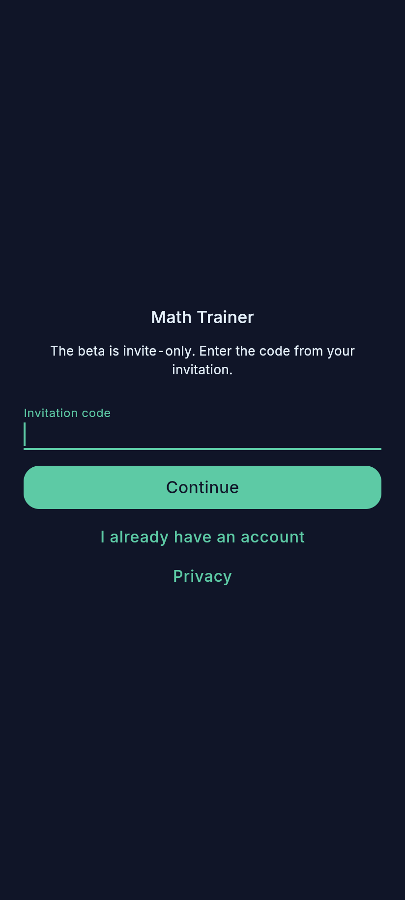
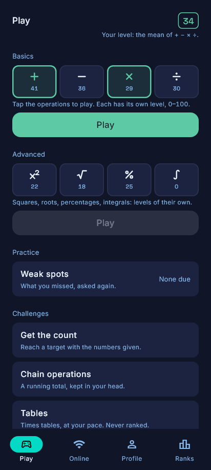
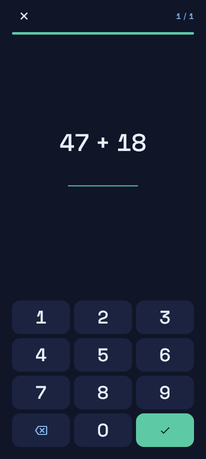
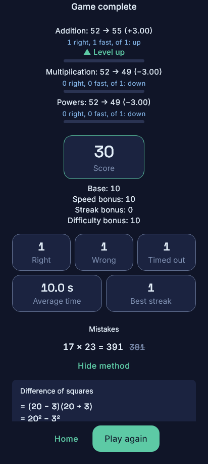
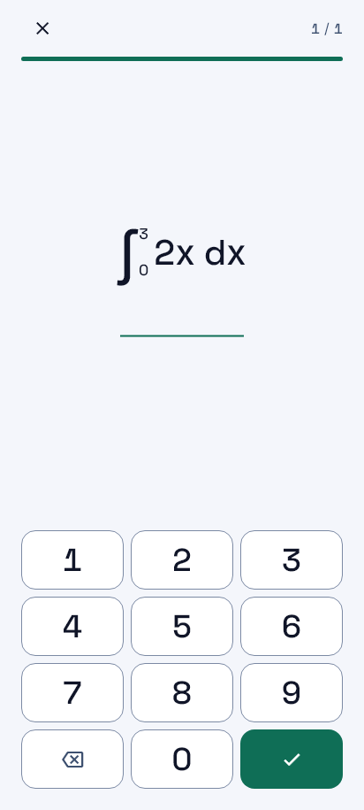
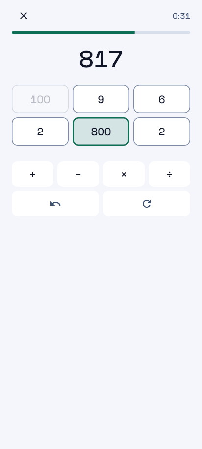
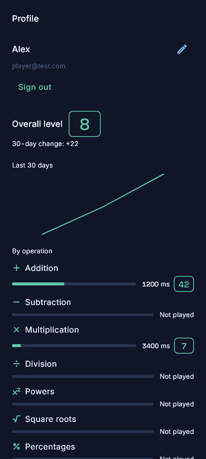
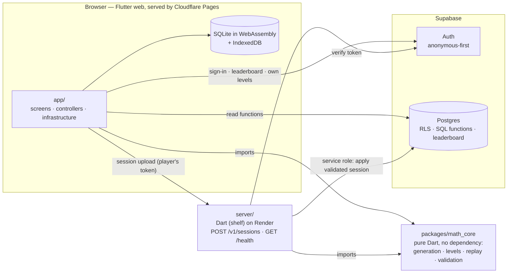

# Math Trainer

A competitive mental-arithmetic game for teens and adults: short timed games, a level per
operation that moves with your real speed and accuracy, a worked method under every mistake, and
a leaderboard computed by a server that trusts nothing the client says.

Flutter, web first (mobile web is the reference device), with a pure-Dart core shared by the app
and a Dart server, on Supabase.

**Live preview: <https://math-trainer-kjc.pages.dev/>.** It's an invite-only beta for now, so the
first screen asks for an invitation code.

## What the game is

- **Eight operations** in two families: *Basics* (+ − × ÷) and *Advanced* (powers, roots,
  percentages, definite integrals of polynomials). Every expected answer is a whole number.
- **Games of 4, 5, 10 or 20 questions per operation**, 30 s per question, an on-screen keypad
  (the native keyboard never opens during a game).
- **Levels 0–100 per operation**, in ten tiers of content. A game moves the level by the credit
  each answer earns (fluent, correct but slow, wrong), with capped gains and a dead band, so
  the level measures skill, not effort. It never decays with absence. Spec:
  [`doc/levels.md`](doc/levels.md#3-how-a-game-moves-a-level).
- **Pattern questions** (49 families: 17 × 23 as a difference of squares, 65 + 98, 43 × 11, 36 × 25 …)
  reward shortcuts, not just digit count, and **every mistake gets a worked method**
  ([spec 5b and 9](doc/levels.md#5b-pattern-questions)).
- **Training mode**, **Tables mode**, a **Tips** page, and two solo challenges: *Get the count*
  (reach a target from six numbers) and *Chain operations*.
- **Anonymous-first accounts**: you play the first game with no form; linking an email keeps the
  same player.
- **Offline first**: solo play never needs the network; games upload later, in order.

## Screenshots

| Live preview (beta gate) | Home | A question | Result with a worked method |
|---|---|---|---|
|  |  |  |  |

| Integrals | Get the count | Profile |
|---|---|---|
|  |  |  |

The first image is a screenshot of the live preview, taken with every write request blocked.
While the beta is invite-only, that's as far as an anonymous visit goes. The others are the
app's **golden test images**: the real widgets rendered at phone width by `flutter test`, in both
themes, compared pixel for pixel on every CI run.

## Architecture

- **`packages/math_core`**: no Flutter and no package dependency. Question generation, the
  level update, the session codec and the server's validation all live here, so the app and the
  server run *the same code*. It's tested on the Dart VM and compiled to JavaScript.
- **`app/`**: strict layers. `presentation/` (screens and a small component kit),
  `core/state/` (`ChangeNotifier` controllers), and `infrastructure/` (the only place that
  imports storage, Supabase or web APIs). One `composition_root.dart` picks the
  implementations.
- **`server/`**: verifies the player's token, **regenerates every question from the seed**,
  re-marks every answer, replays the level update under the session's own rules version, and
  checks that levels chain from the previous session. Then it writes, in one transaction. It's
  an AOT binary in a scratch container.
- **`supabase/`**: versioned SQL migrations applied by CI only. Player data sits behind RLS
  with API grants revoked, and players reach it through `security definer` functions on
  `auth.uid()`. The leaderboard reads only server-written levels.

Details: [`doc/architecture.md`](doc/architecture.md), [`doc/online.md`](doc/online.md)
([data flow](doc/online.md#data-flow-phase-2),
[replay and validation](doc/online.md#replay-and-validation-phase-2-commit-6)).

## Key technical decisions

Every decision is recorded with its reasons and alternatives in
[`doc/decisions.md`](doc/decisions.md). The ones that shape the system:

| Decision | Why |
|---|---|
| [Monorepo with a pure-Dart core](doc/decisions.md#monorepo-app-packagesmath_core-server) and a [separate Dart server](doc/online.md#backend-supabase--a-dart-server) rather than Edge Functions | Supabase Edge Functions run TypeScript, and a second implementation of the level maths would drift. The server imports the core unchanged. |
| [Same questions on VM, JavaScript and WebAssembly](doc/decisions.md#cross-platform-determinism-pinned-references-vm-and-javascript-phase-1-commit-1) | Server replay and future duels depend on it. Explicit seeds, integer-only maths (no `pow`, `exp`, floating `sqrt`), and pinned reference sequences checked on VM and JS. |
| [Self-contained sessions](doc/decisions.md#self-contained-sessions-the-type-sequence-is-stored-phase-2-commit-1) with a [rules version](doc/decisions.md#levels-close-out--rules-v3-the-level-update-tuned-plan-v32-23-nov-2026) | Every session stores everything that decided its questions, so any old game can be replayed under the rules it was played with (v2, v3 and v4 coexist). |
| [The server validates by replay and level chaining](doc/decisions.md#validation-the-chain-of-levels-and-adopting-the-servers-phase-2-commit-6) | "The server never trusts the client": correctness, level updates and order are recomputed. Implausible timing is flagged, not refused. |
| [Integer hundredths for levels](doc/decisions.md#continuous-levels-in-integer-hundredths-phase-1-commit-2), [levels as a recomputable cache](doc/decisions.md#levels-are-a-recomputable-cache-not-a-source-of-truth) | Exact, platform-independent arithmetic. History is the source of truth. |
| Generation builds the result (draw *r*, show *r²*) and never uses rejection sampling | Bounded time, uniform control over content, and it makes "exact division" and "whole-number percentages" true by construction. |
| [Anonymous-first accounts](doc/decisions.md#anonymous-first-replaces-mandatory-sign-in) | A first-time player reaches a question with no form. Linking keeps the user id, and deletion is one SQL function. |
| [Offline first: the local database is the upload queue](doc/decisions.md#uploads-the-local-database-is-the-queue-sent-in-order-phase-2-commit-5), [SQLite in WebAssembly](doc/decisions.md#web-persistence-sqlite-in-webassembly-sqflite_common_ffi_web) | The same SQL schema on web and mobile. Uploads go oldest first and are idempotent on the session id. |
| [SQL migrations applied by CI, tested on plain Postgres](doc/decisions.md#sql-migrations-applied-by-ci-tested-on-plain-postgres-phase-2-commit-2) | No SQL by hand. Every migration is applied twice in tests to prove it's idempotent. |
| [Staging, then production, with a read-only production smoke test](doc/decisions.md#staging-a-second-project-deploys-in-order-production-smoke-read-only-phase-52-commit-1--provisional) | Tests never write to the testers' project. |
| First load: [nothing from Google CDNs](doc/decisions.md#first-load-nothing-from-google-a-loading-screen-with-real-progress-phase-1-commit-3), [pre-compressed brotli on Cloudflare](doc/decisions.md#first-load-pre-compressed-files-on-cloudflare-phase-51-commit-1), [sign-in during the download](doc/decisions.md#first-load-sign-in-during-the-download-levels-read-ahead-inter-cut-phase-51-commit-1) | Flutter web is several MB before the first frame. Load time is measured on slow-4G profiles and attacked at each step. |
| [Native `ChangeNotifier`](doc/decisions.md#native-changenotifier-rather-than-provider--riverpod--bloc), no state-management package | Enough for the app's needs, with one less dependency. |
| [Invariants by `throw`, never `assert`](doc/decisions.md#assert-does-not-defend-an-invariant--use-throw-rule-13) | Asserts vanish from release builds. Each invariant has a test of the invalid case. |
| [Sound synthesised with Web Audio](doc/decisions.md#sound-synthesised-in-the-browser-on-by-default-phase-5-commit-4), [a digit typeface cut to digits and operators](doc/decisions.md#digit-typeface-space-grotesk-cut-to-digits-phase-5-commit-1) | Identity without download weight. |

## How it was built

This is a solo project built with [Claude Code](https://claude.com/claude-code) as the
implementer, under a written process:

1. **A product plan owned by me**: [`doc/plan.md`](doc/plan.md), now at version 3.3. It says what
   the app is, why, and in what order it's built. Each version records the outcome of the
   previous phase and the decisions it raised. Claude Code reads it and never edits it.
2. **Binding specifications** for the hard parts. For example, [`doc/levels.md`](doc/levels.md)
   defines the level scale, the tiers, the update formula, the 49 pattern families and the
   Method. The code is checked against its tables, not just against earlier tests.
3. **Working rules in [`CLAUDE.md`](CLAUDE.md)**: 18 architecture rules, conventions, the
   commands, and a "pitfalls" list that grows with every lesson learned (it records each bug
   class once, with the guard that prevents it).
4. **One-pass phases.** A phase is a numbered list of commits with an exit test. Claude Code runs
   the whole phase without stopping. It plans each commit, implements it, tests and documents it,
   commits and pushes. Decisions that come up mid-phase are taken on evidence (simulation or
   measurement), marked *provisional* in `doc/decisions.md`, and confirmed or reversed by me in
   the phase report. Only a short list of hard stops (data loss, a secret about to leak, a red
   build after two attempts …) can interrupt a phase. [Why](doc/decisions.md#phases-run-in-one-pass).
5. **Reviews and guards.** Claude Code hooks ([`tool/hooks/`](tool/hooks)) refuse edits that break
   a rule (an `assert` in the core, an unseeded `Random()`) and format every edited file. A
   read-only [reviewer subagent](.claude/agents/reviewer.md) checks each diff against the
   rules. Each phase ends with a report: delivered vs plan, deviations, provisional decisions,
   what couldn't be verified, debt, numbers. I review it and play a checklist on my phone.
6. **Everything is logged**: [`doc/progress.md`](doc/progress.md) has one line per commit, by
   phase.

**Timeline.** An MVP in August 2026, then from the plan of 18 November 2026: Phase 0 (CI and web
pipeline), 1 (first run and accounts), 2 (server and leaderboard), 3a (invite-only beta),
5 (visual identity, sound, haptics), 5.1–5.2 (first-load work, staging), the Redesign (game
modes and new interface), Levels (new level system) and Patterns and Method. That's 121 of the
172 commits, in six days.

## Tests and CI

| Suite | Tests |
|---|---|
| Core on the Dart VM (`packages/math_core`, `dart test`) | 686 |
| Core compiled to JavaScript (`dart test -p node`) | 659 |
| App (`flutter test`: unit, widget and golden tests in both themes) | 408 |
| Server (`server/`, `dart test`) | 36 |
| Tooling (hook rules) | 10 |
| SQL (`supabase/tests/`, 14 files) | migrations applied twice, then the tests, on a scratch Postgres |

Some suites drive whole flows. The app tests play games through the real builders and then
validate the uploads with the server's code, and the core suite runs simulated players to check
that the level-tuning targets still hold.

**CI** ([`.github/workflows/ci.yml`](.github/workflows/ci.yml), 15 jobs) runs on every push and
pull request:

- formatting; analyzer with `--fatal-infos`; core tests on VM and JavaScript;
- app analyzer and tests, golden images included;
- the server's tests, plus its container is built and must answer `/health`;
- SQL migrations and tests on Postgres.

On `main` it then deploys in order:

1. staging, when enabled: migrations → server → web → read/write smoke test;
2. production: migrations → server (deploy hook, waits until `/health` reports the commit) →
   web on Cloudflare Pages → smoke test.

The smoke test ([`tool/smoke/preview_smoke.mjs`](tool/smoke/preview_smoke.mjs)) is a headless
Chrome driven over DevTools: a fresh visitor gets a guest, plays a game, reloads, checks
history and sound, and deletes the account. Against production it is read-only. A weekly
[Android workflow](.github/workflows/android.yml) compiles the APK so mobile stays cheap to
return to.

Size, for scale: core 8.4 k lines of Dart (75 files), app 12.5 k (91 files), server 0.7 k;
27 SQL migrations.

## Repository layout

| Directory | What |
|---|---|
| `app/` | the Flutter app (`flutter test`; `flutter run -d edge --web-port=8080 --dart-define-from-file=dart_defines.json`, see `dart_defines.example.json`) |
| `packages/math_core/` | pure-Dart core shared by the app and the server (`dart test`, `dart test -p node`) |
| `server/` | Dart validation server (`dart test`; `docker build -f server/Dockerfile .` from the root) |
| `supabase/` | SQL migrations (applied by CI) and SQL tests (`bash tool/sql/test_sql.sh <postgres url>`) |
| `tool/` | Claude Code hooks, preview smoke test, SQL test runner, CI scripts, font tools |
| `doc/` | plan, specifications, architecture, decisions, design, progress log, legal drafts |

## Licence

No licence has been chosen yet. Until one is added, all rights are reserved.
